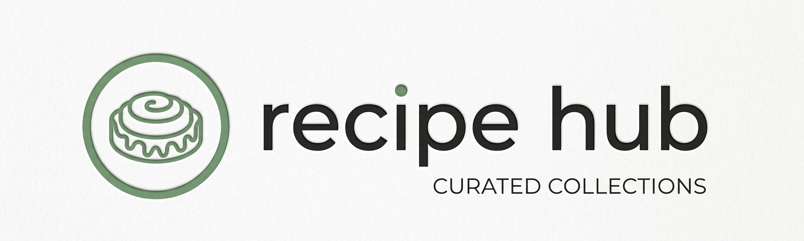
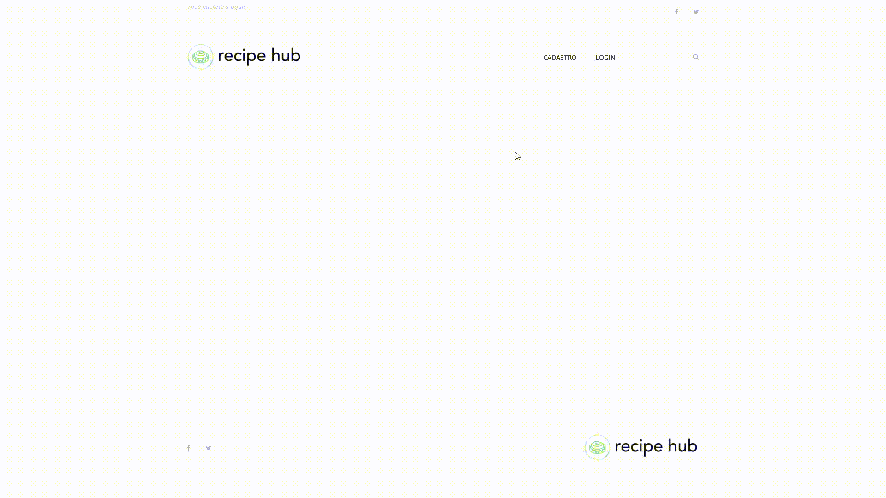
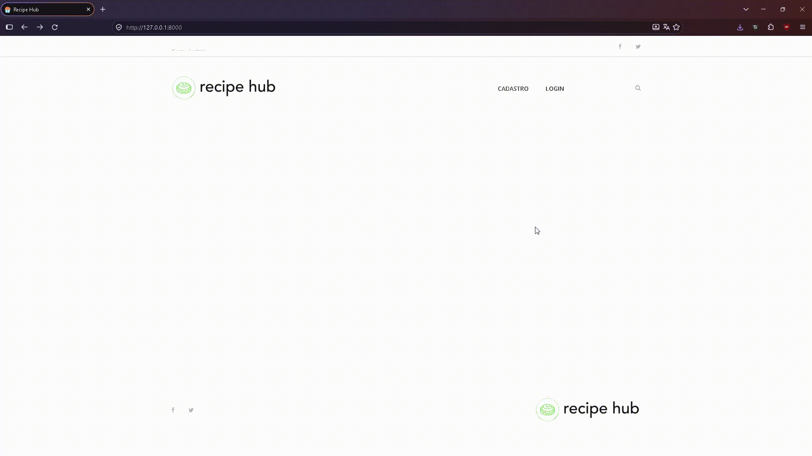
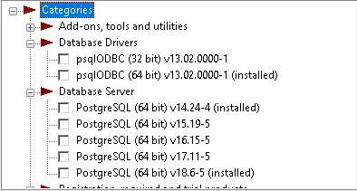
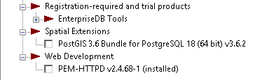

<h1 align="center" style="font-weight: bold;">Recipe Hub</h1>

<p align="center">
    
</p>

[JAVASCRIPT__BADGE]: https://img.shields.io/badge/Javascript-000?style=for-the-badge&logo=javascript
[HTML__BADGE]: https://img.shields.io/badge/HTML-%23E34F26.svg?style=for-the-badge&logo=html5&logoColor=white
[JQUERY__BADGE]: https://img.shields.io/badge/jQuery-%230769AD.svg?style=for-the-badge&logo=jquery&logoColor=white
[PYTHON__BADGE]: https://img.shields.io/badge/Python-%233776AB.svg?style=for-the-badge&logo=python&logoColor=white
[POSTGRESQL__BADGE]: https://img.shields.io/badge/PostgreSQL-%234169E1.svg?style=for-the-badge&logo=postgresql&logoColor=white
[DJANGO__BADGE]: https://img.shields.io/badge/Django-%23092E20.svg?style=for-the-badge&logo=django&logoColor=white
[CSS__BADGE]: https://img.shields.io/badge/CSS3-%231572B6.svg?style=for-the-badge&logo=css3&logoColor=white

<p align="center">
 <a href="#tech">Tecnologias</a> • 
 <a href="#started">Iniciando</a> • 
 <a href="#colab">Colaboradores</a> •
 <a href="#contribute">Contribua</a>
</p>

<p align="center">
    <b>Este é o Recipe Hub, um pequeno site em que os usuários podem criar suas contas, cadastrar suas receitas, editá-las, deletá-las e acessá-las quando quiser. O admin do site escolhe as melhores receitas para colocar no dashboard principal!.</b>
</p>

<h2 id="layout">🎨 Preview</h2>

<p align="center">
    
    
</p>

<h2 id="technologies">💻 Tecnologias</h2>

<div>

![javascript][JAVASCRIPT__BADGE]
![HTML][HTML__BADGE]
![CSS][CSS__BADGE]
![jQuery][JQUERY__BADGE]
![Python][PYTHON__BADGE]
![PostgreSQL][POSTGRESQL__BADGE]
![Django][DJANGO__BADGE]

</div>

<h2 id="started">🚀 Iniciando</h2>

<h3>Pré-requisitos</h3>

Lista dos pré-requisitos. Exemplos:

- [VScode](https://github.com/microsoft/vscode)
- [Python](https://github.com/python)
- [PostgreSQL](https://github.com/postgres)
- [Django](https://github.com/django)

<h3>Baixar o Python</h3>

Clique <a href="https://www.python.org/downloads/">aqui</a> para instalar o python em sua máquina. Sem isso nada funciona!

<h3>Baixar o PostgreSQL</h3>

Clique <a href="https://www.enterprisedb.com/downloads/postgres-postgresql-downloads">aqui</a> para instalar o PostgreSQL em sua máquina. Dentro do Wizard de instalação do PostGreSQL, baixe as aplicações que estão com a tag "(installed)".

<p align="center">
    
    <br>
    
</p>

<h3>Clonando o repositório</h3>

Clone o repositório do projeto em sua máquina e abra-o no VScode.

```bash
git clone https://github.com/JoaoxVictorMS/Recipe_Hub.git
```

<h3>Configurando o settings.py</h2>

Abra o arquivo `settings.py` dentro da pasta `recipehub`. Dentro dele, vá na variável `DATABASE` e mude a senha para uma que desejar ou mantenha aquela mesmo

```python
DATABASES = {
    'default': {
        'ENGINE': 'django.db.backends.postgresql',
        'NAME': 'recipe_hub',
        'USER': 'postgres',
        'PASSWORD': '4100.143', # Coloque a senha que desejar
        'HOST': 'localhost'
    }
}
```

O restante do arquivo já está devidamente configurado.

<h3>Criando o Banco de Dados</h2>

Com o PostgreSQL devidamente instalado, abra o `pgAdmin4` -> abra a aba `Servers` -> clique em `PostgreSQl 18` -> coloque a MESMA senha colocada na variável `DATABASES` -> Clique com o botão esquerdo em `Databases` -> Clique em `Create` e depois em `Database` -> Coloque o nome do Database como `recipe_hub`, o mesmo configurado na variável `DATABASE` em `settings.py`

<h3>Criando o .venv</h3>

Com o Python e o PostgreSQL instalados e configurados, abra o terminal do seu VScode dentro do projeto e crie um novo arquivo .venv

```bash
python3 -m venv .venv
```

Após instalado, execute o script de ativação da sua venv.

```bash
.venv\Scripts\Activate.ps1
```

Linux

```bash
.venv\Scripts\activate.bat
```

<h3>Dependências</h3>

Baixe as dependências do projeto.

```bash
pip install -r requirements.txt
```

<h3>Executando</h3>

Criando as migrações dos modelos do ORM para o PostgreSQL

```bash
python manage.py makemigrations
```

Executando e criando as tabelas dentro do PostgreSQL

```bash
python manage.py migrate
```

Executando o projeto

```bash
python manage.py runserver
```

<h3>Admin User</h3>

Crie o usuario Admin para poder acessar a página de administração

```bash
python manage.py createsuperuser
```

Coloque as credenciais que deseja e acesse o painel de admin via `localhost:8000/admin`

<h2 id="colab">🤝 Colaboradores</h2>

Um agradecimento especial a todas as pessoas que contribuíram para este projeto.

<table>
  <tr>
    <td align="center">
      <a href="#">
        <br>
        <sub>
          <b>João Victor</b>
        </sub>
      </a>
    </td>
  </tr>
</table>

<h2 id="contribute">📫 Contribua</h2>

Fique livre para contribuir como desejar

1. `git clone https://github.com/JoaoxVictorMS/Recipe_Hub.git`
2. Faça as suas contribuições
3. Abra um Pull Request explicando um pouco do que foi feito e aguarde!

<h3>Documentações que podem ajudar</h3>

[📝 Como criar um Pull Request](https://www.atlassian.com/br/git/tutorials/making-a-pull-request)

[💾 Padrão de commit](https://gist.github.com/joshbuchea/6f47e86d2510bce28f8e7f42ae84c716)
